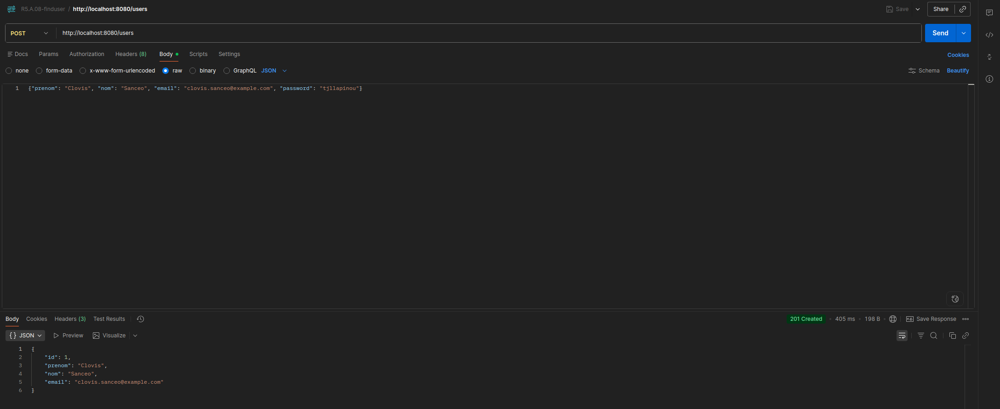
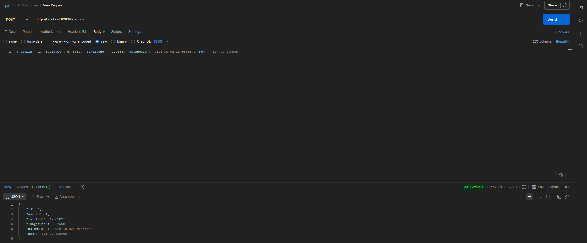
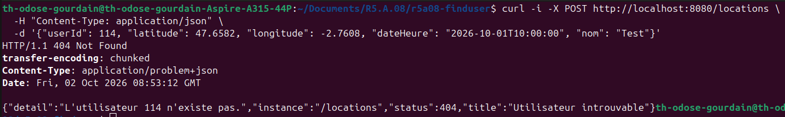

# R5.A.08 - Qualité de développement
# TP2 - Implémentation de microservices

Théodose GOURDAIN et Clovis SANCEO 3A2

Backend composé de deux microservices Spring Boot, chacun avec sa propre base PostgreSQL (*Database per Service*), derrière une API Gateway. MS-Location vérifie l'existence des utilisateurs auprès de MS-User par un appel **gRPC** interne, qui ne passe jamais par la Gateway.

## Architecture

| Composant | Rôle | Port(s) dans le conteneur | Publié sur l'hôte |
|---|---|---|---|
| `api-gateway` | Point d'entrée unique, routage (aucune logique métier) | 8080 | **oui** (seul) |
| `ms-user` | Comptes utilisateurs, serveur gRPC `UserService` | 8081 (REST), 9090 (gRPC) | non |
| `ms-location` | Localisations GPS, client gRPC de MS-User | 8082 | non |
| `user-db` | PostgreSQL de MS-User | 5432 | non |
| `location-db` | PostgreSQL de MS-Location | 5432 | non |

## Lancer le projet

Depuis la racine du projet, à côté du fichier `docker-compose.yml` :

```bash
docker compose up --build -d
```

Toutes les requêtes passent par `http://localhost:8080`.

| Ressource | URL |
|---|---|
| API Users | `http://localhost:8080/users` |
| API Locations | `http://localhost:8080/locations` |
| Documentation Open API | `http://localhost:8080/swagger-ui.html` |

Arrêt : `docker compose down` (ajouter `-v` pour supprimer les données des bases).


## MS-User

### Modèle

| Champ | Type | Description |
|---|---|---|
| `id` | `Long` | Identifiant unique généré par la base |
| `prenom` | `String` | Prénom de l'utilisateur |
| `nom` | `String` | Nom de l'utilisateur |
| `email` | `String` | Email unique de l'utilisateur |
| `password` | `String` | Mot de passe haché (BCrypt), **jamais renvoyé** dans les réponses |

### Routes

| Méthode | Route | Rôle | Succès | Erreurs |
|---|---|---|---|---|
| `POST` | `/users` | Créer un utilisateur | 201 | 400 |
| `GET` | `/users` | Lister les utilisateurs | 200 | — |
| `GET` | `/users/{id}` | Lire un utilisateur | 200 | 404 |
| `PUT` | `/users/{id}` | Modifier un utilisateur | 200 | 404 |
| `DELETE` | `/users/{id}` | Supprimer un utilisateur **et ses localisations** | 204 | 404, 503 |

Exemple de corps pour `POST /users` :

```json
{
  "prenom": "Clovis",
  "nom": "Sancéo",
  "email": "clovis.sanceo@example.com",
  "password": "jesuisunmotdepasse"
}
```

### Suppression en cascade

Chaque microservice ayant sa propre base, il n'existe pas de clé étrangère entre utilisateurs et localisations. La suppression est donc orchestrée par MS-User :

1. Vérifier que l'utilisateur existe (sinon 404) ;
2. Appeler la route interne de MS-Location `DELETE /interne/users/{id}/locations` ;
3. Si l'appel réussit, supprimer l'utilisateur ; sinon renvoyer une **503** sans rien supprimer.

Supprimer les localisations **avant** l'utilisateur garantit qu'un échec ne laisse jamais de localisations orphelines, et la requête peut être rejouée sans risque. La route interne n'est pas routée par la Gateway : elle est inaccessible depuis l'extérieur.

### Serveur gRPC

MS-User expose `UserService.GetUser` sur le port 9090 (contrat `user.proto`, voir plus bas). La réflexion gRPC est active, ce qui permet d'utiliser `grpcurl` sans fournir le `.proto`.

---

## MS-Location

### Modèle

| Champ | Type | Description |
|---|---|---|
| `id` | `Long` | Identifiant unique généré par la base |
| `userId` | `Long` | Identifiant de l'utilisateur (relié à MS-User), non modifiable après création |
| `latitude` | `Double` | Entre -90 et 90 |
| `longitude` | `Double` | Entre -180 et 180 |
| `dateHeure` | `LocalDateTime` | Date de l'enregistrement, non dans le futur (colonne `date_heure`) |
| `nom` | `String` | Nom de la localisation, non vide |

### Routes

| Méthode | Route | Rôle | Succès | Erreurs |
|---|---|---|---|---|
| `POST` | `/locations` | Enregistrer une localisation (vérifie l'utilisateur en gRPC) | 201 | 400, 404, 503 |
| `GET` | `/locations` | Lister toutes les localisations | 200 | — |
| `GET` | `/locations/{id}` | Lire une localisation | 200 | 404 |
| `GET` | `/locations?userId=…` | Lister les localisations d'un utilisateur (vérifie l'utilisateur en gRPC) | 200 | 404, 503 |
| `PUT` | `/locations/{id}` | Remplacer une localisation (sauf `userId`) | 200 | 400, 404 |
| `DELETE` | `/locations/{id}` | Supprimer une localisation | 204 | 404 |
| `DELETE` | `/interne/users/{id}/locations` | Supprimer toutes les localisations d'un utilisateur — **route interne, non exposée** | 204 | — |

Exemple de corps pour `POST /locations` :

```json
{
  "userId": 1,
  "latitude": 47.6582,
  "longitude": -2.7608,
  "dateHeure": "2026-10-01T10:00:00",
  "nom": "IUT de Vannes"
}
```

## Communication gRPC

Contrat partagé, identique dans `ms-user/src/main/proto/` et `ms-location/src/main/proto/` :

```protobuf
syntax = "proto3";

option java_multiple_files = true;
option java_package = "r5a08.finduser.grpc.user";

service UserService {
  rpc GetUser (UserRequest) returns (UserReply);
}

message UserRequest {
  string id = 1;
}

message UserReply {
  string id = 1;
  string nom = 2;
  string prenom = 3;
  bool exists = 4;
}
```

## API Gateway

| Routes | Destination |
|---|---|
| `/users/**` | MS-User |
| `/locations/**` | MS-Location |
| `/docs/users` | spécification OpenAPI de MS-User |
| `/docs/locations` | spécification OpenAPI de MS-Location |

La Gateway met à disposition un Swagger UI de Open API pour les deux APIs : `http://localhost:8080/swagger-ui/index.html`.


## Docker Compose

### Réseaux

| Réseau | Services | Trafic |
|---|---|---|
| `gateway-net` | api-gateway, ms-user, ms-location | REST nord-sud |
| `internal-net` | ms-user, ms-location | gRPC est-ouest, route interne de suppression |
| `user-db-net` | ms-user, user-db | JDBC |
| `location-db-net` | ms-location, location-db | JDBC |

Seul le port **8080** de la Gateway est publié sur l'hôte. Les bases disposent d'un `healthcheck` (`pg_isready`) : les microservices ne démarrent qu'une fois leur base prête.

### Variables d'environnement

| Service | Variable | Valeur |
|---|---|---|
| api-gateway | `MS_USER_URI` | `http://ms-user:8081` |
| api-gateway | `MS_LOCATION_URI` | `http://ms-location:8082` |
| ms-user | `SPRING_DATASOURCE_URL` | `jdbc:postgresql://user-db:5432/userdb` |
| ms-user | `MS_LOCATION_URI` | `http://ms-location:8082` |
| ms-location | `SPRING_DATASOURCE_URL` | `jdbc:postgresql://location-db:5432/locationdb` |
| ms-location | `USER_SERVICE_GRPC_TARGET` | `ms-user:9090` |

Hors Docker, chaque application utilise des valeurs par défaut pointant vers `localhost`.

## Tests (exercice 5)

Tests réalisés en Docker Compose, sur des bases neuves, via la Gateway (`localhost:8080`).

### 1. REST via la Gateway (Postman)

| Requête | Attendu | Obtenu |
|---|---|---|
| `POST /users` (Clovis Sancéo) | 201, mot de passe absent | 201 |
| `POST /locations` (`userId` 1) | 201 | 201 |

**Capture 1 — Postman : création d'un utilisateur**



**Capture 2 — Postman : création d'une localisation pour cet utilisateur**



### 2. gRPC isolé (grpcurl)

```bash
grpcurl -plaintext -d '{"id": "1"}' localhost:9090 UserService/GetUser
```

Résultat : `exists: true`, avec l'identifiant, le nom et le prénom.

**Capture 3 — grpcurl : appel direct à MS-User**


### 3. Cas d'erreur

| Requête | Attendu | Obtenu |
|---|---|---|
| `POST /locations` (`userId` 114) | 404, pas de 500 | 404 « L'utilisateur 114 n'existe pas. » |

**Capture 4 — curl : POST avec utilisateur inexistant**



## Points de vigilance et discussion

### Évolution du contrat gRPC

Si un champ est ajouté à UserReply sans régénérer les stubs de MS-Location, il n’y a pas d’erreur qui est déclenchée. MS-Location continue de fonctionner et ignore le nouveau champ. En revanche, si on régénère ses stubs, cela déclenche une erreur car MS-Location veut un champ qui n’est pas disponible. Même chose si on change le type d’un champ existant.