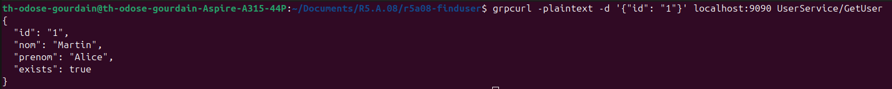
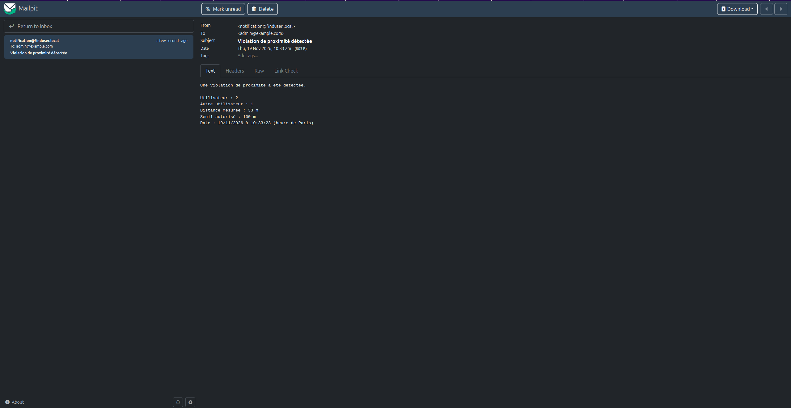

# R5.A.08 - Qualité de développement
# TP3 - Architecture orientée événements avec Kafka

Théodose GOURDAIN et Clovis SANCEO 3A2

Backend composé de deux microservices Spring Boot, chacun avec sa propre base PostgreSQL (Database per Service), derrière une API Gateway. MS-Location vérifie l'existence des utilisateurs auprès de MS-User par un appel gRPC interne, qui ne passe jamais par la Gateway.

A cela s'ajoute une détection en temps quasi réel des violations de proximité entre utilisateurs devant rester éloignés. MS-Location publie chaque nouvelle position dans Kafka, MS-Proximity-Detection la compare aux règles stockées dans Redis et publie les violations, puis MS-Notification envoie un email à l'administrateur.

## GitHub

L'ensemble du code de ce projet est disponible dans un dépôt GitHub : https://github.com/TheodoseGourdain/r5a08-finduser.

## Architecture

Les nouveaux services ne se connaissent pas entre eux : chacun ne connaît que les **topics** Kafka. MS-Location ignore l'existence de MS-Proximity-Detection, qui ignore celle de MS-Notification. Si MS-Notification est arrêté, les violations restent dans Kafka et sont traitées à son redémarrage.

| Composant | Rôle | Port(s) dans le conteneur | Publié sur l'hôte |
|---|---|---|---|
| `api-gateway` | Point d'entrée unique, routage (aucune logique métier) | 8080 | **oui** |
| `ms-user` | Comptes utilisateurs, serveur gRPC `UserService` | 8081 (REST), 9090 (gRPC) | non |
| `ms-location` | Localisations GPS, client gRPC de MS-User, producteur Kafka | 8082 | non |
| `ms-proximity-detection` | Détection des violations (consommateur et producteur Kafka) | aucun | non |
| `ms-notification` | Envoi des emails (consommateur Kafka) | aucun | non |
| `user-db` | PostgreSQL de MS-User | 5432 | non |
| `location-db` | PostgreSQL de MS-Location | 5432 | non |
| `kafka` | Broker Kafka (mode KRaft, sans Zookeeper) | 9092 (conteneurs), 29092 (hôte) | 29092 (outils de développement) |
| `kafka-init` | Crée les deux topics au démarrage, puis s'arrête | — | non |
| `redis` | Stockage des règles de proximité | 6379 | non |
| `mailpit` | Serveur SMTP de test avec interface web | 1025 (SMTP), 8025 (web) | oui (consultation des emails) |

L'API reste accessible uniquement par la Gateway. Les ports 29092 (Kafka) et 8025/1025 (Mailpit) sont publiés pour le développement et les tests.

## Lancer le projet

Depuis la racine du projet, à côté du fichier `docker-compose.yml` :

```bash
docker compose up --build -d
./redis-init.sh
```

La première commande construit et démarre tous les services. `kafka-init` crée les topics puis s'arrête : son état `Exited (0)` dans `docker compose ps -a` est normal, il s'agit uniquement de l'initialisation.

La seconde charge les règles de proximité de test dans Redis (voir [Règles de proximité](#règles-de-proximité-redis)). Grâce au volume `redis-data`, elle n'est nécessaire qu'au premier lancement, ou après un `docker compose down -v`. Si le script n'est pas exécutable, il faut exécuter la commande `chmod +x redis-init.sh` pour donner les droits d'exécution au fichier.

Toutes les requêtes passent par `http://localhost:8080`.

| Ressource | URL |
|---|---|
| API Users | `http://localhost:8080/users` |
| API Locations | `http://localhost:8080/locations` |
| Documentation Open API | `http://localhost:8080/swagger-ui.html` |
| Emails reçus (Mailpit) | `http://localhost:8025` |

Arrêt : `docker compose down` (ajouter `-v` pour supprimer les données des bases, de Kafka et de Redis).

### Vérifier le contenu des topics

Le projet utilise deux topics Kafka : `user.location.updated`, qui transporte les nouvelles positions des utilisateurs, et `proximity.violation.detected`, qui transporte les violations de distance détectées. Une fois tous les conteneurs lancés, les commandes ci-dessous affichent les événements présents dans chaque topic :

```bash
docker exec kafka kafka-console-consumer --bootstrap-server kafka:9092 \
  --topic user.location.updated --from-beginning --property print.key=true --timeout-ms 5000
docker exec kafka kafka-console-consumer --bootstrap-server kafka:9092 \
  --topic proximity.violation.detected --from-beginning --property print.key=true --timeout-ms 5000
```

- `--from-beginning` lit le topic depuis le premier événement encore conservé (7 jours par défaut) ;
- `print.key=true` affiche la clé de chaque message (le `userId`) avant son contenu JSON ;
- `--timeout-ms 5000` arrête la commande après 5 secondes sans nouveau message, au lieu d'attendre indéfiniment.

## MS-User

### Modèle

| Champ | Type | Description |
|---|---|---|
| `id` | `Long` | Identifiant unique généré par la base |
| `prenom` | `String` | Prénom de l'utilisateur |
| `nom` | `String` | Nom de l'utilisateur |
| `email` | `String` | Email unique de l'utilisateur |
| `password` | `String` | Mot de passe haché (BCrypt), **jamais renvoyé** dans les réponses |

### Routes

| Méthode | Route | Rôle | Succès | Erreurs |
|---|---|---|---|---|
| `POST` | `/users` | Créer un utilisateur | 201 | 400 |
| `GET` | `/users` | Lister les utilisateurs | 200 | — |
| `GET` | `/users/{id}` | Lire un utilisateur | 200 | 404 |
| `PUT` | `/users/{id}` | Modifier un utilisateur | 200 | 404 |
| `DELETE` | `/users/{id}` | Supprimer un utilisateur **et ses localisations** | 204 | 404, 503 |

Exemple de corps pour `POST /users` :

```json
{
  "prenom": "Clovis",
  "nom": "Sancéo",
  "email": "clovis.sanceo@example.com",
  "password": "jesuisunmotdepasse"
}
```

### Suppression en cascade

Chaque microservice ayant sa propre base, il n'existe pas de clé étrangère entre utilisateurs et localisations. La suppression est donc orchestrée par MS-User :

1. Vérifier que l'utilisateur existe (sinon 404) ;
2. Appeler la route interne de MS-Location `DELETE /interne/users/{id}/locations` ;
3. Si l'appel réussit, supprimer l'utilisateur ; sinon renvoyer une **503** sans rien supprimer.

Supprimer les localisations **avant** l'utilisateur garantit qu'un échec ne laisse jamais de localisations orphelines, et la requête peut être rejouée sans risque. La route interne n'est pas routée par la Gateway : elle est inaccessible depuis l'extérieur.

### Serveur gRPC

MS-User expose `UserService.GetUser` sur le port 9090 (contrat `user.proto`, voir plus bas). La réflexion gRPC est active, ce qui permet d'utiliser `grpcurl` sans fournir le `.proto`.

---

## MS-Location

### Modèle

| Champ | Type | Description |
|---|---|---|
| `id` | `Long` | Identifiant unique généré par la base |
| `userId` | `Long` | Identifiant de l'utilisateur (relié à MS-User), non modifiable après création |
| `latitude` | `Double` | Entre -90 et 90 |
| `longitude` | `Double` | Entre -180 et 180 |
| `dateHeure` | `LocalDateTime` | Date de l'enregistrement, heure de Paris, non dans le futur (colonne `date_heure`) |
| `nom` | `String` | Nom de la localisation, non vide |

### Routes

| Méthode | Route | Rôle | Succès | Erreurs |
|---|---|---|---|---|
| `POST` | `/locations` | Enregistrer une localisation (vérifie l'utilisateur en gRPC) et publier l'événement Kafka | 201 | 400, 404, 503 |
| `GET` | `/locations` | Lister toutes les localisations | 200 | — |
| `GET` | `/locations/{id}` | Lire une localisation | 200 | 404 |
| `GET` | `/locations?userId=…` | Lister les localisations d'un utilisateur (vérifie l'utilisateur en gRPC) | 200 | 404, 503 |
| `PUT` | `/locations/{id}` | Remplacer une localisation (sauf `userId`) | 200 | 400, 404 |
| `PATCH` | `/locations/{id}` | Modifier partiellement une localisation (seuls les champs fournis, sauf `userId`) | 200 | 400, 404 |
| `DELETE` | `/locations/{id}` | Supprimer une localisation | 204 | 404 |
| `DELETE` | `/interne/users/{id}/locations` | Supprimer toutes les localisations d'un utilisateur — **route interne, non exposée** | 204 | — |

Exemple de corps pour `POST /locations` :

```json
{
  "userId": 1,
  "latitude": 47.6582,
  "longitude": -2.7608,
  "dateHeure": "2026-10-01T10:00:00",
  "nom": "IUT de Vannes"
}
```

### Publication des événements

À chaque `POST /locations`, une fois la localisation enregistrée, MS-Location publie un événement dans le topic `user.location.updated` (voir [Contrats des événements](#contrats-des-événements)).

- **Conversion vers le contrat** : `userId` est converti en chaîne, et `dateHeure` (heure de Paris, sans fuseau) en instant UTC au format ISO (`2026-11-19T09:15:00Z`).
- **Clé du message** : le `userId`. Tous les événements d'un même utilisateur vont dans la même partition, ce qui garantit leur ordre si le topic gagne un jour plusieurs partitions.
- **Sérialisation** : le JSON est produit avec Jackson et envoyé sous forme de chaîne (`StringSerializer`). On évite ainsi le `JsonSerializer` de Spring Kafka, qui ajoute un en-tête contenant le nom de la classe Java de l'émetteur, inconnue des consommateurs.
- **Découplage** : le service métier ne dépend que de l'interface `LocationEventPublisher`, implémentée par `KafkaLocationEventPublisher`. Même principe que `UserVerifier` pour le gRPC.

#### Attention

- **Seul le `POST` publie un événement.** Une localisation est une ligne d'historique. Un `PUT` ou un `PATCH` corrige une ligne existante, qui peut être ancienne ou ne changer que le `nom`. Publier dans ce cas ferait croire à MS-Proximity-Detection que l'utilisateur se trouve *maintenant* à une position passée.
- **Un échec de publication ne fait pas échouer la requête.** Si Kafka est indisponible, la localisation est enregistrée, le client reçoit sa 201 après 5 secondes au plus (`max.block.ms: 5000`, au lieu de 60 secondes par défaut), et l'erreur est journalisée. Les échecs synchrones (broker injoignable lors de l'envoi) et asynchrones (échec après l'envoi) sont tous deux journalisés.

---

## MS-Proximity-Detection

Microservice sans route HTTP. Il consomme `user.location.updated` (groupe `ms-proximity-detection`) et publie dans `proximity.violation.detected`.

### Traitement d'une position

1. **Mémoriser** la position comme dernière position connue de l'utilisateur (`ConcurrentHashMap` en mémoire), **sauf si elle est plus ancienne** que celle déjà connue : une position périmée ou en double est ignorée.
2. **Lire dans Redis** les utilisateurs dont celui-ci doit rester éloigné (`restricted:users:{userId}`).
3. Pour chacun d'eux dont la position est connue, **lire le seuil** (`restricted:threshold:{userId}:{otherUserId}`) et **calculer la distance** avec la formule de **Haversine** (distance à vol d'oiseau à la surface de la Terre, rayon moyen de 6 371 km).
4. Si `distance < seuil`, **publier une violation**. La distance est arrondie au mètre, et le `timestamp` est l'instant de la détection.

---

## MS-Notification 

Consomme `proximity.violation.detected` (groupe `ms-notification`) et envoie, pour chaque violation, un email à l'administrateur avec `JavaMailSender`. L'email contient les identifiants des deux utilisateurs, la distance mesurée, le seuil autorisé et la date de détection, convertie à l'heure de Paris.

Les emails sont envoyés à **Mailpit**, un serveur SMTP de test : aucun email réel n'est envoyé, et les messages reçus sont consultables sur `http://localhost:8025`.

---

## Contrats des événements

Ces formats sont le contrat entre les services, l'équivalent du `user.proto` pour le gRPC. Chaque service possède sa propre classe Java : seul le format JSON est partagé. Les identifiants sont des chaînes, les dates sont au format ISO 8601 en UTC.

| Topic | Producteur | Consommateur |
|---|---|---|
| `user.location.updated` | MS-Location | MS-Proximity-Detection |
| `proximity.violation.detected` | MS-Proximity-Detection | MS-Notification |

**`user.location.updated`** (clé : `userId`) :

```json
{
  "userId": "1",
  "latitude": 47.6582,
  "longitude": -2.7608,
  "timestamp": "2026-11-19T09:15:00Z"
}
```

**`proximity.violation.detected`** (clé : `userId`) :

```json
{
  "userId": "2",
  "otherUserId": "1",
  "distance": 33,
  "threshold": 100.0,
  "timestamp": "2026-11-19T09:22:37Z"
}
```

Les deux topics ont une partition et un facteur de réplication de 1 (un seul broker).

## Règles de proximité (Redis)

| Clé | Type | Contenu |
|---|---|---|
| `restricted:users:{userId}` | Set | Utilisateurs dont `userId` doit rester éloigné |
| `restricted:threshold:{userId}:{otherUserId}` | String | Distance minimale à respecter, en mètres |

Chaque règle est enregistrée **dans les deux sens** : une règle n'est vérifiée que lorsque l'utilisateur qui se déplace la possède. Si seul `restricted:users:1` contenait `2`, un déplacement de l'utilisateur 2 vers l'utilisateur 1 ne serait pas détecté.

Le script `redis-init.sh` charge le jeu de test (utilisateurs 1 et 2, au moins 100 m) :

```
SADD restricted:users:1 2
SADD restricted:users:2 1
SET restricted:threshold:1:2 100
SET restricted:threshold:2:1 100
```

Redis et Kafka ont des rôles distincts : Kafka transporte les événements, qui sont immuables, et Redis stocke les règles métier, qui peuvent changer à tout moment sans redéployer de service.

## Communication gRPC

Contrat partagé, identique dans `ms-user/src/main/proto/` et `ms-location/src/main/proto/` :

```protobuf
syntax = "proto3";

option java_multiple_files = true;
option java_package = "r5a08.finduser.grpc.user";

service UserService {
  rpc GetUser (UserRequest) returns (UserReply);
}

message UserRequest {
  string id = 1;
}

message UserReply {
  string id = 1;
  string nom = 2;
  string prenom = 3;
  bool exists = 4;
}
```

## API Gateway

| Routes | Destination |
|---|---|
| `/users/**` | MS-User |
| `/locations/**` | MS-Location |
| `/docs/users` | spécification OpenAPI de MS-User |
| `/docs/locations` | spécification OpenAPI de MS-Location |

La Gateway met à disposition un Swagger UI de Open API pour les deux APIs : `http://localhost:8080/swagger-ui/index.html`.


## Docker Compose

### Réseaux

| Réseau | Services | Trafic |
|---|---|---|
| `gateway-net` | api-gateway, ms-user, ms-location | REST nord-sud |
| `internal-net` | ms-user, ms-location | gRPC est-ouest, route interne de suppression |
| `user-db-net` | ms-user, user-db | JDBC |
| `location-db-net` | ms-location, location-db | JDBC |
| `backend` | ms-location, ms-proximity-detection, ms-notification, kafka, kafka-init, redis, mailpit | Kafka, Redis, SMTP |

### Ordre de démarrage

`depends_on` attend par défaut le lancement d'un conteneur, pas que le service soit prêt. Des `healthcheck` règlent ce problème :

- les bases PostgreSQL (`pg_isready`) : MS-User et MS-Location attendent leur base ;
- Kafka (`kafka-topics --list`) : `kafka-init` attend que le broker réponde ;
- `kafka-init` : MS-Location, MS-Proximity-Detection et MS-Notification attendent qu'il soit **terminé avec succès**, donc que les topics existent ;
- Redis (`redis-cli ping`) : MS-Proximity-Detection attend que Redis réponde.

### Kafka

- **Mode KRaft** (rôles `broker,controller` dans le même nœud), sans Zookeeper. L'image `confluentinc/cp-kafka` exige une variable `CLUSTER_ID` en mode KRaft.
- **Deux listeners** : `kafka:9092` pour les conteneurs, `localhost:29092` pour l'hôte (IDE, outils en ligne de commande).
- **Volume** `kafka-data` : les topics et les messages survivent aux redémarrages.

### Variables d'environnement

| Service | Variable | Valeur |
|---|---|---|
| api-gateway | `MS_USER_URI` | `http://ms-user:8081` |
| api-gateway | `MS_LOCATION_URI` | `http://ms-location:8082` |
| ms-user | `SPRING_DATASOURCE_URL` | `jdbc:postgresql://user-db:5432/userdb` |
| ms-user | `MS_LOCATION_URI` | `http://ms-location:8082` |
| ms-location | `SPRING_DATASOURCE_URL` | `jdbc:postgresql://location-db:5432/locationdb` |
| ms-location | `USER_SERVICE_GRPC_TARGET` | `ms-user:9090` |
| ms-location | `KAFKA_BOOTSTRAP_SERVERS` | `kafka:9092` |
| ms-proximity-detection | `KAFKA_BOOTSTRAP_SERVERS` | `kafka:9092` |
| ms-proximity-detection | `REDIS_HOST` / `REDIS_PORT` | `redis` / `6379` |
| ms-notification | `KAFKA_BOOTSTRAP_SERVERS` | `kafka:9092` |
| ms-notification | `MAIL_HOST` / `MAIL_PORT` | `mailpit` / `1025` |
| ms-notification | `ADMIN_EMAIL` | `admin@example.com` |

Hors Docker, chaque application utilise des valeurs par défaut pointant vers `localhost` (Kafka sur `localhost:9092`).

## Tests

Tests réalisés en Docker Compose via la Gateway, après `./redis-init.sh` (règle : utilisateurs 1 et 2 à au moins 100 m).

### 1. REST via la Gateway (Postman)

| Requête | Attendu | Obtenu |
|---|---|---|
| `POST /users` (Clovis Sancéo) | 201, mot de passe absent | 201 |
| `POST /locations` (`userId` 1) | 201 | 201 |

**Capture 1 — Postman : création d'un utilisateur**


**Capture 2 — Postman : création d'une localisation pour cet utilisateur**


### 2. gRPC isolé (grpcurl)

```bash
grpcurl -plaintext -d '{"id": "1"}' localhost:9090 UserService/GetUser
```

Résultat : `exists: true`, avec l'identifiant, le nom et le prénom.

**Capture 3 — grpcurl : appel direct à MS-User**



### 3. Cas d'erreur

| Requête | Attendu | Obtenu |
|---|---|---|
| `POST /locations` (`userId` 114) | 404, pas de 500 | 404 « L'utilisateur 114 n'existe pas. » |

**Capture 4 — curl : POST avec utilisateur inexistant**


### 4. Chaîne complète : violation détectée

| Étape | Requête | Attendu | Obtenu |
|---|---|---|---|
| 1 | `POST /locations` utilisateur 1 en (47.6582, -2.7608) | 201, position publiée, pas de violation (position de 2 inconnue) | 201 |
| 2 | `POST /locations` utilisateur 2 en (47.6585, -2.7608), soit 33 m | 201, violation publiée, email reçu | 201, email reçu : distance 33 m, seuil 100 m |

**Capture 5 — Mailpit : email de violation reçu par l'administrateur**




## Points de vigilance et discussion

### Évolution du contrat gRPC

Si un champ est ajouté à UserReply sans régénérer les stubs de MS-Location, il n'y a pas d'erreur qui est déclenchée. MS-Location continue de fonctionner et ignore le nouveau champ. En revanche, si on régénère ses stubs, cela déclenche une erreur car MS-Location veut un champ qui n'est pas disponible. Même chose si on change le type d'un champ existant.

### Limites de l'architecture événementielle

- **Position enregistrée sans événement.** Si Kafka est indisponible, la localisation est enregistrée en base, mais son événement est perdu, et MS-Proximity-Detection ne la voit jamais. La solution classique est le pattern *Transactional Outbox* : enregistrer l'événement dans une table de la même base, dans la même transaction que la localisation, puis le publier par un processus séparé.
- **État en mémoire.** MS-Proximity-Detection garde les dernières positions en mémoire. Après un redémarrage, il ne connaît plus aucune position jusqu'au prochain déplacement de chaque utilisateur. On pourrait stocker ces positions dans Redis, ou relire le topic depuis le début au démarrage.
- **Notifications répétées.** Tant que deux utilisateurs restent proches, chaque nouvelle position déclenche une violation, donc un email. Un mécanisme simple serait de ne pas republier la même violation pendant quelques minutes (par exemple avec une clé Redis à durée de vie limitée).
- **Sécurité.** Kafka fonctionne en `PLAINTEXT` : n'importe quel processus du réseau `backend` peut produire ou consommer sur les topics. L'authentification (SASL, mTLS) et les ACL par topic relèvent du CM Sécurité des architectures.